**KR** | [EN](README.md)

# 취업재판 · job hiring court (KR)

[](https://github.com/LSH2007-tech/job-hiring-court-KR/actions/workflows/tests.yml)
[](LICENSE)

**내 자소서를 법정에 세워 보자.** 취업재판은 자기소개서를 채용 공고에 맞대어 채용 위원회처럼 따지는 Claude 스킬입니다. 탈락 위원(검사)과 합격 위원(변호인)이 공방을 벌이고, 배심원 세 명(인사, 임원, 실무)이 서로의 표를 보지 못한 채 투표하고, 판사가 판결과 구체적인 수정 조언을 내립니다.

> **이 재판의 특징:** 채용 공고의 직무(JD)와 내 스킬을 맞춰 보고, 어떤 직무가 맞는지, 그 직무에 맞춰 자소서를 어떻게 완성해야 합격 가능성을 높일 수 있는지 돕는 AI입니다. 요즘 채용은 직무 JD와 지원자 스킬의 매칭을 매우 중요하게 보기 때문에, 꾸며 쓴 문장보다 그 매칭부터 분석합니다.

> **v1.6.6:** 보안 사항을 업데이트하였습니다.

> **계속 고치는 중입니다.** 실제 지원 결과를 보며 규칙, 화면, 점수 계산을 계속 고치고 있어 버전마다 달라질 수 있습니다. 현재 플러그인 버전: v1.6.6.

- **브라우저에서 바로 써 보기(설치 없음):** https://lsh2007-tech.github.io/job-hiring-court-KR/app/
- **소개와 설치 안내:** https://lsh2007-tech.github.io/job-hiring-court-KR/
- **스킬 설명:** [hiring-court/README.md](hiring-court/README.md)

**목차:** [쓰는 방법 두 가지](#쓰는-방법-두-가지) · [플러그인 설치](#플러그인-설치) · [단계별 사용법](#단계별-사용법) · [판결 규칙](#판결-규칙) · [1회 사용량](#재판-1회-사용량) · [실제 사용 결과](#왜-만들었고-어떻게-시험했나) · [개인정보](#개인정보와-저장-위치) · [개발](#개발) · [hiring-panel과 비교](#부록-취업재판-vs-hiring-panel) · [라이선스](#라이선스와-출처)

## 쓰는 방법 두 가지

| | 브라우저 앱 | Claude Code 플러그인 |
|---|---|---|
| 설치 | 없음. 페이지를 열면 됩니다 | Claude Code(로그인) + Python 3.10 이상 |
| Claude 요금 | 내 **Claude API 키**로, 쓴 만큼 | 내 **Claude 구독** 안에서 (Pro, Opus 5.5 기준 재판 한 번에 5시간 사용 한도의 약 20~30%) |
| 돌아가는 곳 | 브라우저가 Claude API를 직접 부릅니다 | 내 PC의 로컬 서버(`localhost`)가 Claude Code를 부릅니다 |
| 지원자 기록 | 파일 올리기(이력서, 경력기술서, 기존 자소서) | 파일 올리기 또는 **노션** 연동(읽기 전용) |
| 저장 | 재판 기록을 ZIP으로 내려받기 | 내가 고른 폴더에 저장 |

두 방식 모두 운영 서버가 없습니다. 내 문서를 보는 것은 나와 Anthropic뿐입니다.

## 플러그인 설치

터미널에서 Claude Code를 실행한 뒤 아래 두 줄을 입력합니다.

```
/plugin marketplace add LSH2007-tech/job-hiring-court-KR
/plugin install hiring-court@lsh-skills
```

PDF와 Word를 더 정확하게 읽으려면 아래 라이브러리 설치를 권장합니다(선택).

```
python -m pip install "markitdown[pdf,docx,pptx,xlsx]"
```

판마다 태그(`v1.6.6` 등)를 붙이고, 바뀐 내용은 [CHANGELOG](hiring-court/CHANGELOG.md)에 적습니다.

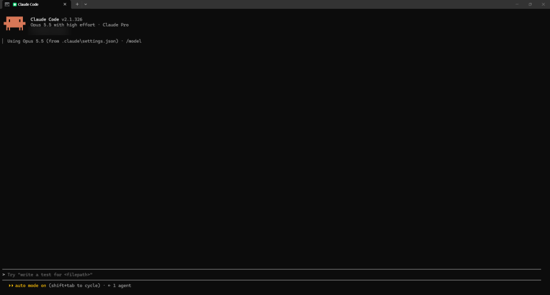

## 단계별 사용법

아래 화면은 실제 지원 공고와 자기소개서로 재판을 한 번 끝까지 진행하며 캡처했습니다. 개인정보는 흐리게 가렸습니다.

### 시작: 실행과 지원자 기록 연결

설치가 끝나면 Claude Code에 **`취업 재판 시작해줘`** 라고 말하면 됩니다. 그러면 내 PC에서 취업재판 웹 화면(`localhost`)이 자동으로 열립니다. 대화 안에서 진행하고 싶다면 `서류 재판 열어 줘`라고 말하면 됩니다.

재판을 시작하기 전에, 이전에 지원했던 내용이나 미리 만들어 둔 파일(이력서, 경력기술서, 기존 자소서)을 넣을 수 있게 구성했습니다. 넣지 않아도 START로 바로 시작할 수 있습니다.

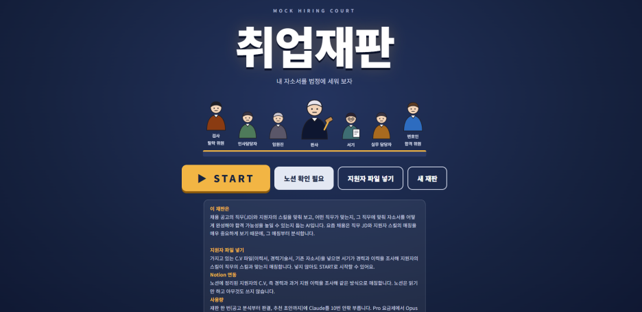

저는 Notion에 기업별 JD 분석과 자기소개서, 지원 현황을 따로 정리해 두었습니다.

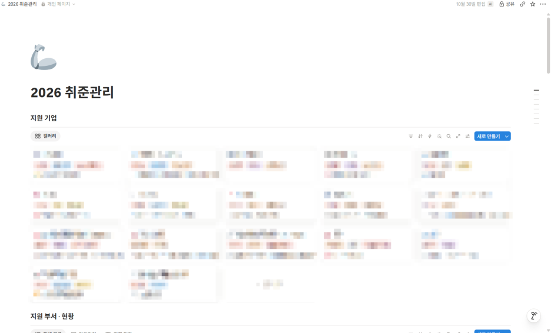

노션을 연동하면 Claude가 Notion에서 이력서, 경험 정리, 지원 현황, 자기소개서를 찾아 지원자 자료로 정리해 보여 줍니다. 내 기록이 맞는지 확인하고 ‘맞아요’를 누릅니다.

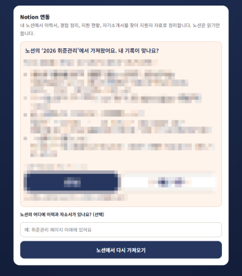

시작 화면에 ‘노션 연동됨’이 표시되면 준비가 끝난 것입니다.

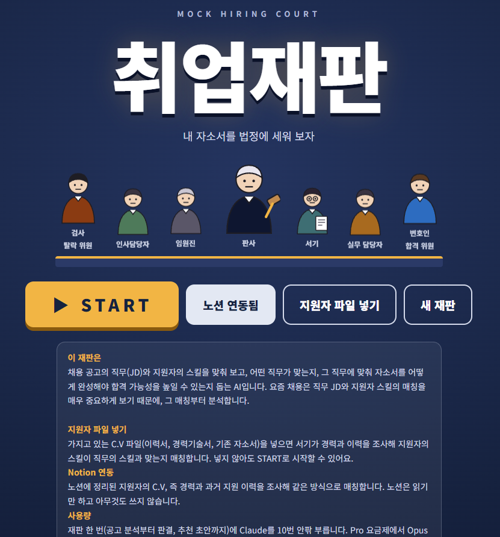

> [!TIP]
> Notion을 쓰려면 Claude Code에 Notion 커넥터를 `notion`이라는 이름으로 등록하고 한 번 로그인해야 합니다. 취업재판은 Notion을 **읽기만** 하고 아무것도 쓰지 않습니다. Notion을 쓰지 않는다면 ‘지원자 파일 넣기’로 이력서, 경력기술서, 기존 자기소개서 파일을 올려도 됩니다.

### 0단계: 공고 접수와 공고 분석

연동이 끝나면 0단계인 공고 접수 화면으로 넘어갑니다.

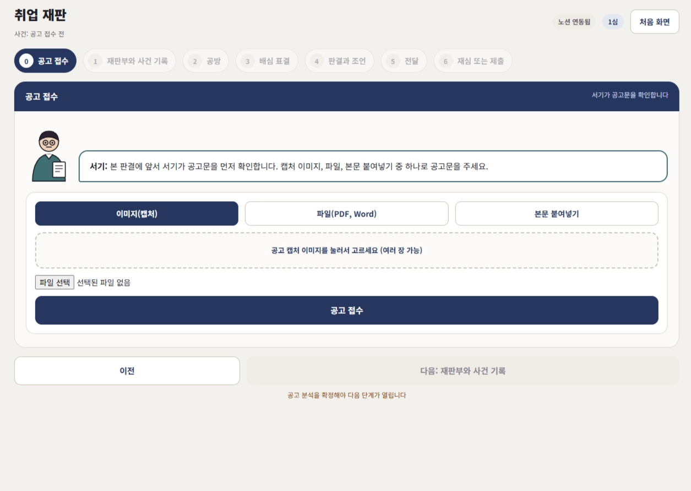

공고는 세 가지 방법으로 넣을 수 있습니다.

- **캡처 이미지**: JD 공고를 캡처해 이미지 파일로 넣습니다. 여러 장을 함께 넣을 수 있습니다.
- **파일(PDF, Word, 한글)**: 공고 페이지에서 Ctrl + P → ‘PDF로 저장’으로 공고문을 PDF로 만들어 넣습니다.
- **본문 붙여넣기**: 공고 페이지 전체를 복사해 붙여 넣습니다.

파일(PDF, Word)로 넣는 방법을 권장합니다. 링크는 받지 않습니다. 채용 사이트 대부분이 링크만으로는 공고 본문을 보여 주지 않기 때문입니다. 공고 파일을 넣은 뒤 ‘공고 접수’ 버튼을 누르면 서기가 공고문 분석을 시작합니다.

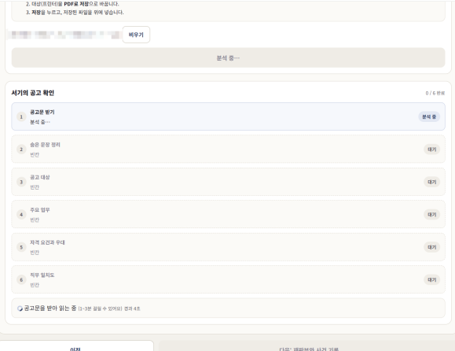

분석은 아래 순서로 진행됩니다.

1. **공고문 받기와 숨은 문장 정리**: 글자 수를 세고, 공고 안에 숨은 문장이나 AI 심사기를 겨냥한 지시문이 없는지 확인해 걸러 냅니다.
2. **공고 대상 확인**: 신입 공고인지 경력 공고인지 구분합니다.
3. **주요 업무, 자격 요건과 우대 사항**을 살펴봅니다.
4. **직무 일치도 분석**: 앞서 넣은 Notion과 이력서 데이터를 바탕으로 내 경험이 이 직무와 얼마나 맞는지 분석합니다.

공고문을 모두 읽고 나면 ‘공고 분석’ 결과를 보여 줍니다. 여기에 더해 Claude가 웹에서 해당 공고와 관련된 최신 기사를 직접 찾아옵니다.

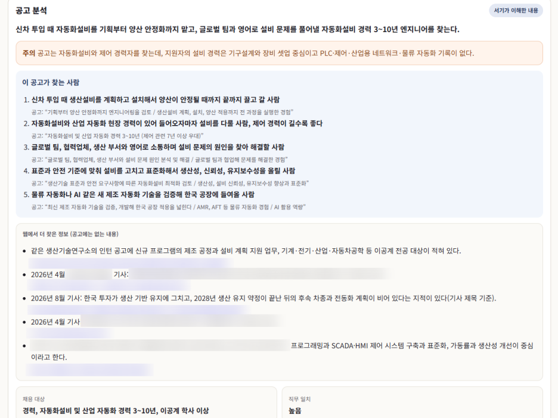

이력서를 바탕으로 ‘내 경험과 이 직무의 일치도’를 보여 줍니다. 공고의 주요 업무 한 줄 한 줄을 **직접 해 본 일 / 비슷한 경험 / 비어 있는 곳**으로 나눠 표시합니다. 서기가 공고를 잘못 이해했을 수 있으니, 빠진 내용이나 공고에는 없지만 알고 있는 정보가 있다면 ‘추가 정보’에 적어 주세요. 분석을 마치려면 ‘이대로 분석 마치기’를 누릅니다.

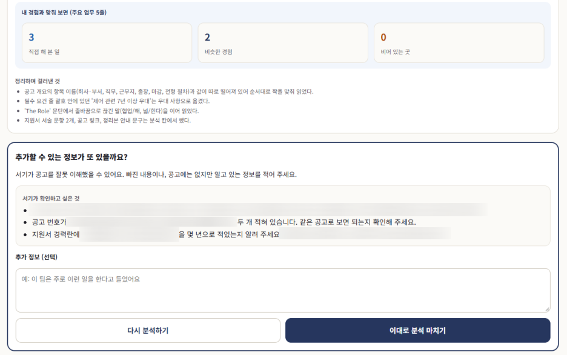

직무 일치도는 이후 배심원이 줄 수 있는 점수 범위를 정하는 기준이 됩니다.

| 직무 일치도 | 배심원 점수 기준 구간 |
|---|---|
| 높음 | 45~80% |
| 중간 | 20~50% |
| 낮음 | 5~25% |

### 1단계: 재판부 구성과 자기소개서 제출

#### 재판부 세우기

1단계에서는 JD에 맞춰 재판부를 세웁니다. 공고의 핵심 내용을 바탕으로 배심원을 인사담당자, 임원, 실무 담당자로 나눴습니다. 인사담당자와 실무 담당자는 Sonnet, 임원은 Opus 모델을 씁니다.

다른 평가 도구와 달리, 실제로 조사한 JD를 기준으로 각 배심원이 직무에서 어떤 역할을 맡는지, 어떤 성격의 담당자인지 설정합니다. 임원과 실무 담당자의 관점은 웹에서 찾은 현직자 자료(조직장 인터뷰, 기술 발표, 현직자 후기, 회사 동향)로 세우고, 출처를 기록에 남깁니다.

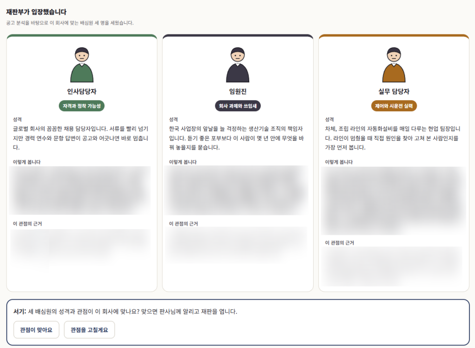

세 배심원의 관점이 맞다고 생각되면 ‘관점이 맞아요’를, 더 넣고 싶은 관점이 있다면 ‘관점을 고칠게요’를 선택합니다. 인사, 임원, 실무 담당자에 대해 따로 아는 정보가 있다면 여기서 직접 넣을 수 있습니다.

#### 자기소개서 제출

기업마다 문항 1, 문항 2처럼 여러 질문이 있으므로, 문항과 글자 수 제한, 답변을 직접 입력할 수 있게 만들었습니다. ‘문항 추가’로 문항을 늘릴 수 있습니다.

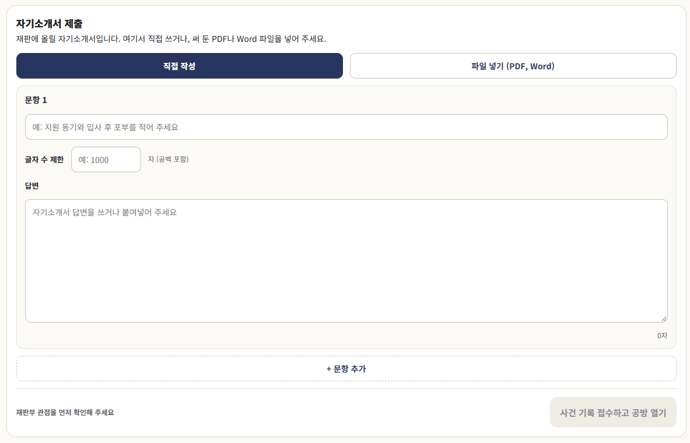

아직 써 둔 자기소개서가 없다면 아래의 ‘AI 추천 초안’을 쓸 수 있습니다.

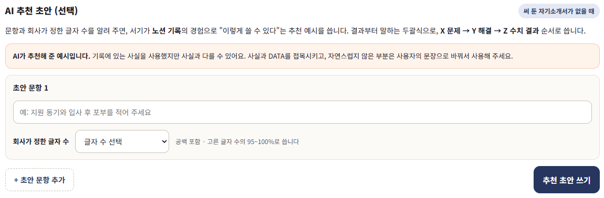

AI 추천 초안은 인사담당자가 읽기 쉬운 두괄식과 XYZ 구조(X 문제 → Y 해결과 이유 → Z 수치 결과)로 씁니다. 없는 내용은 지어내지 않습니다. Notion 데이터와 이력서를 살펴보고, 이 직무에 필요한 경험과 불필요한 경험을 가려서 초안에 넣습니다. 그래도 초안은 예시이므로, 사실과 다른 부분이 없는지 확인하고 내 문장으로 바꿔 쓰세요.

이미 써 둔 자기소개서가 있다면 ‘파일 넣기’로 PDF, Word, 한글 파일을 넣을 수 있습니다. 여기서는 예시로 미리 작성해 둔 자기소개서(PDF)를 넣고 ‘사건 기록 접수하고 공방 열기’를 눌러 진행해 보겠습니다.

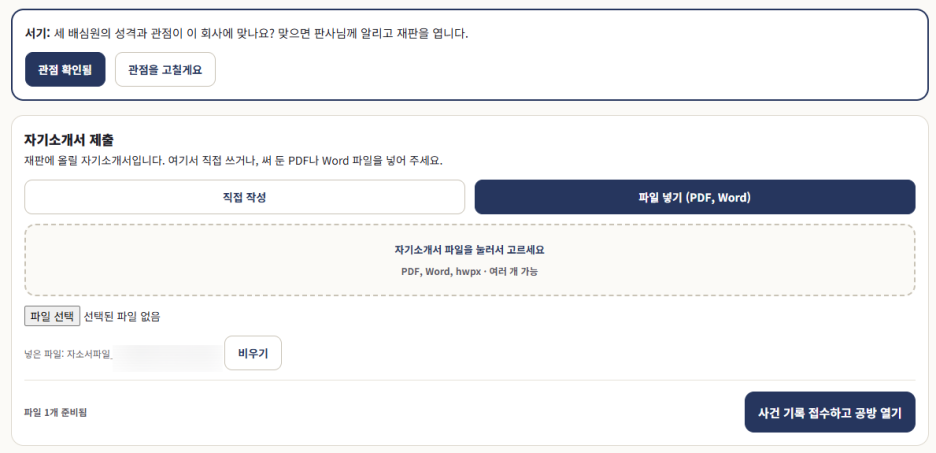

### 2단계: 공방

공방에서는 JD와 지원자의 자기소개서, 이력서를 살펴본 뒤 양측이 논쟁을 펼칩니다.

- **검사(탈락 위원)**: 탈락시킬 이유를 찾아 공격합니다.
- **변호인(합격 위원)**: 합격시켜야 할 이유로 방어합니다.

공방은 모두진술(최대 800자) → 반박(최대 400자) → 핵심 쟁점 순서로 진행됩니다. 이 공방에서는 **JD와 맞지 않는 부분을 찾는 것이 0순위**로 설정되어 있습니다.

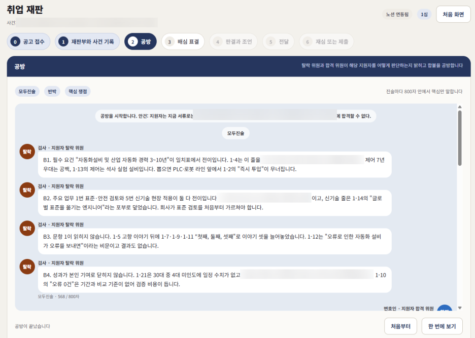

예시로 넣은 JD와 자기소개서는 제가 이 스킬로 점검한 뒤 실제로 지원한 건입니다. 검사는 JD와 맞지 않는 부분을 근거로 탈락을 주장하고, 변호인은 합격시키기 위한 반론을 펼칩니다. 실제로 써 보면 자기소개서가 JD와 얼마나 맞는지를 가장 중점적으로 따진다는 것을 확인할 수 있습니다.

### 3단계: 배심 표결

공방이 끝나면 앞서 세운 배심원 3명(인사담당자, 임원, 실무 담당자)이 표결합니다. 세 배심원은 동시에, 서로의 표를 모르는 상태에서 독립적으로 투표합니다.

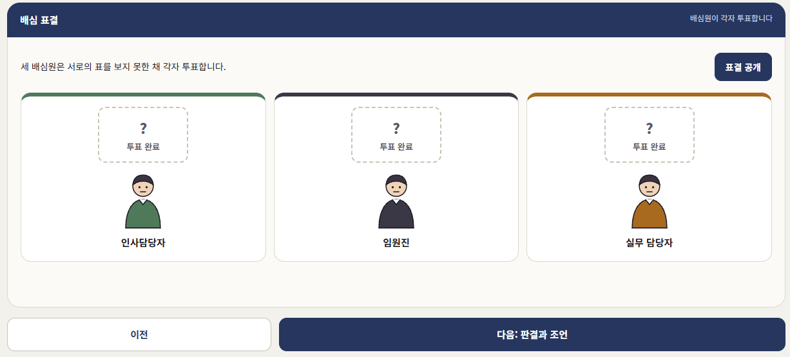

‘표결 공개’를 누르면 합격과 불합격으로 나뉜 결과와 그 이유가 나옵니다. 합격 가능성이 몇 %인지, 어떤 점이 부합하고 어떤 점이 부족했는지 설명하며, 그 아래에 ‘배심원별 판단’이 이어집니다. 확인을 마쳤다면 ‘판결과 조언’을 눌러 다음 단계로 넘어갑니다.

### 4단계: 판결과 조언

서기가 배심원단의 표결과 공방 내용을 모아 서류 예측을 계산하고, 판사가 판결을 선고합니다.

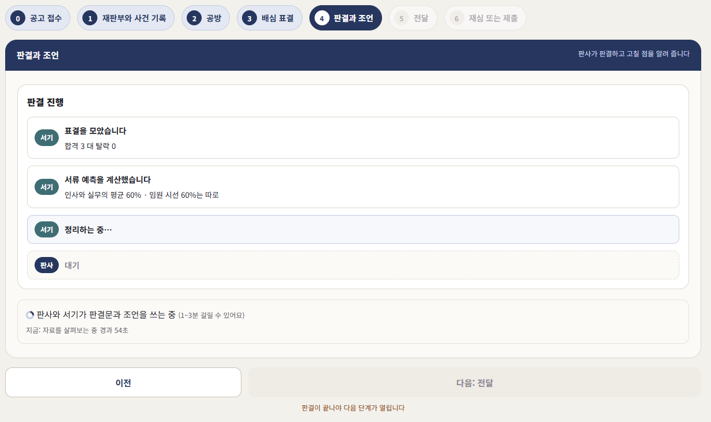

판결은 [판결 규칙](#판결-규칙)에 따라 정해집니다. 판결문에는 인정된 탈락 사유와 합격 위원이 옳았던 점이 함께 나옵니다.

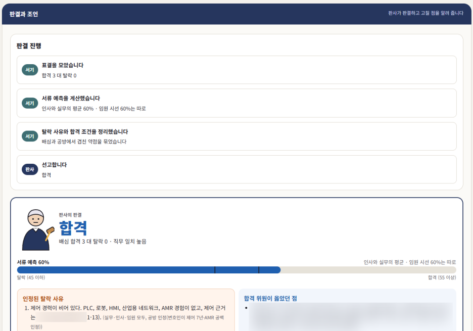

아래에는 이 직무에서 다른 지원자보다 승률을 높이려면 무엇을 고쳐야 하는지 ‘이기려면 이렇게 고치세요’가 나옵니다. 문제마다 지금 문제, 고치는 방법, 쓸 경험(내 기록 근거), 문장 예시를 보여 줍니다. 이 JD 기준으로 지원자의 약점을 분석하고, 그 약점을 강점으로 바꿀 방법을 함께 고민할 수 있게 만들었습니다.

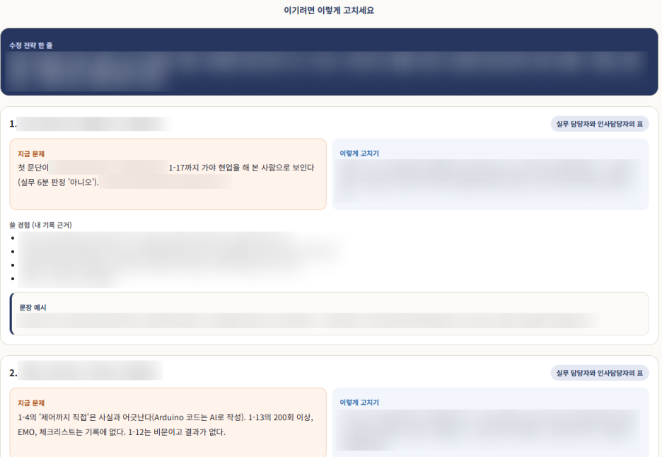

맨 아래에서 ‘수정해서 재심 청구’를 누르면 고친 자기소개서를 다시 제출해 재판을 한 번 더 받을 수 있고, ‘재판 기록 받기’를 누르면 5단계로 넘어갑니다.

### 5단계: 전달

지금까지 진행한 판결문, 조언, 수정본을 받을 수 있고, 공방 기록, 직무 일치표, 사실대조처럼 AI가 분석한 결과도 함께 저장할 수 있습니다.

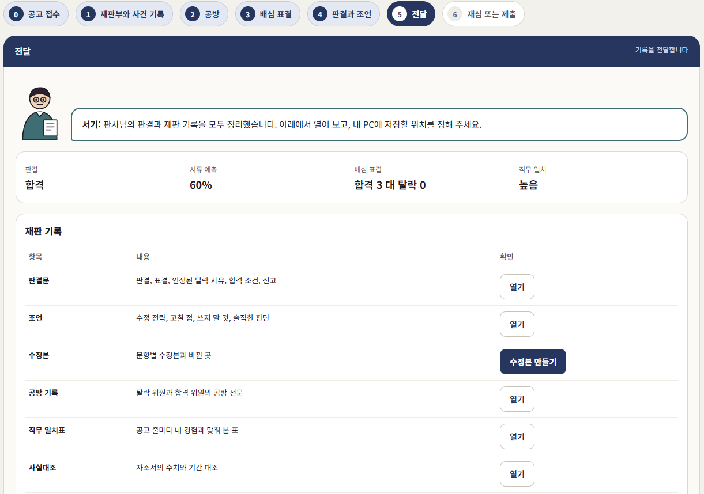

기록은 파일로 저장되며, 내 PC에서 원하는 위치를 골라 저장할 수 있습니다(기본 위치는 `문서/취업재판`). 노션에는 아무것도 쓰지 않습니다.

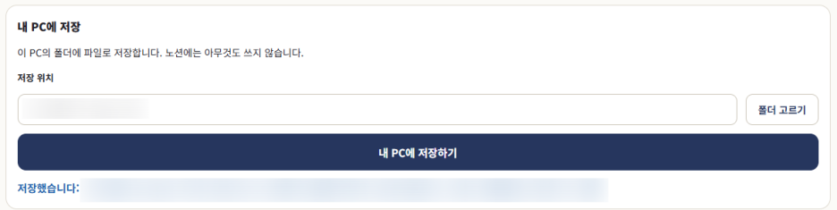

### 6단계: 재심 또는 제출

마지막 6단계에서는 이대로 제출할지, 고쳐서 재심을 청구할지 고릅니다. 재심은 같은 공고, 같은 재판부로 1단계부터 다시 엽니다.

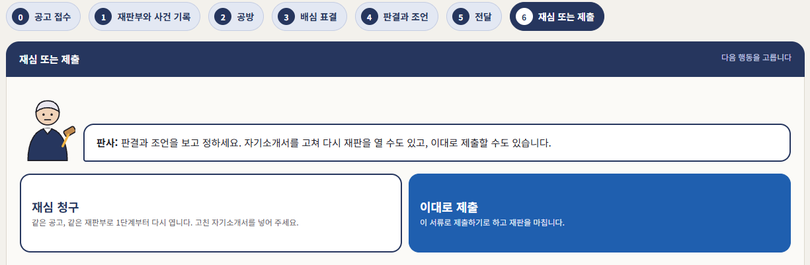

필요한 결과물은 5단계에서 모두 받을 수 있으므로, 사실상 전체 과정은 5단계에서 끝납니다.

## 어떻게 돌아가나

```
0단계  공고 접수      캡처 / PDF나 Word / 붙여넣기 -> 공고 정리본, 직무 일치표
1단계  재판부와 사건   공고(와 웹 조사)로 배심원 3명을 세우고 자소서를 접수
2단계  공방          탈락 위원 대 합격 위원, 진술마다 800자 이내
3단계  배심 표결      인사, 임원, 실무가 각자 투표(동시에 호출)
4단계  판결과 조언    서류 예측 = 인사와 실무의 평균, 고칠 점 목록
5단계  전달          판결문, 조언, 수정본, 기록
6단계  재심 또는 제출
```

- **판단은 Claude가, 숫자는 코드가 셉니다.** 글자 수, 직무 일치도(직접 / 전이 / 공백), 표 검사와 집계는 플러그인에서는 `court_tool.py`가, 브라우저에서는 `engine.js`가 계산합니다. 모델이 세지 않습니다.
- **공고가 먼저입니다.** 잘 쓴 글이어도 공고와 맞지 않으면 집니다. 직무 일치도가 배심원이 투표할 수 있는 구간을 정합니다.
- **공고 속 숨은 지시문은 걸러 냅니다.** 배심원에게 가기 전에 뺍니다.
- 프롬프트와 채점 규칙은 일부러 한국어로 썼습니다. 한국 채용 서류를 다루기 때문입니다. 규칙은 [`SKILL.md`](hiring-court/skills/hiring-court/SKILL.md) 한 파일에 있고 두 방식이 같은 규칙을 씁니다.

```
플러그인:  브라우저(localhost:8765) -> web/server.py -> claude -p (내 로그인) -> court_tool.py
브라우저:  docs/app (GitHub Pages)  -> engine.js     -> Claude API (내 키)    -> 같은 규칙
```

### 판결 규칙

| 규칙 | 내용 |
|---|---|
| 서류 합격 예측 % | 인사담당자와 실무 담당자 점수의 평균 (임원 점수는 ‘임원 시선’으로 따로 표시) |
| 합격 | 55% 이상 |
| 보류(경계) | 45% 초과 55% 미만 |
| 탈락 | 45% 이하 |

## 재판 1회 사용량

웹 화면에서 재판을 한 번 끝까지 진행했을 때(공고 분석, 사건 기록, 공방, 배심 3명, 판결, 추천 초안) 측정한 사용량입니다. (2026-11-14, 1회 측정)

| 항목 | 사용량 |
|---|---|
| Claude 호출 횟수 | 10회 |
| Opus 5.5 출력 토큰 | 약 95,000 |
| Opus 5.5 입력 토큰 | 약 2,500,000 (대부분 캐시 읽기) |
| Sonnet 5.5 출력 토큰 | 약 3,500 |
| Sonnet 5.5 입력 토큰 | 약 250,000 |
| Pro 요금제 기준 | 5시간 사용 한도의 약 20~30% (Opus 5.5, 높은 연산 수준) |

- 대화로 진행하는 서류 재판은 하위 에이전트를 기본 4회(공방 1회 + 배심원 3회) 씁니다. 재실행 규칙에 걸리면 최대 7~8회까지 늘어납니다.
- 자기소개서가 길거나 재심을 청구하면 사용량이 더 늘어납니다.
- 브라우저 앱은 구독 대신 내 API 키로 결제되므로, 쓴 토큰만큼 비용이 나옵니다.
- 처음 쓰는 분은 시작 전에 남은 사용량을 확인하세요.

## 왜 만들었고 어떻게 시험했나

자소서를 Claude 한 명에게 평가받으면 결국 듣기 좋은 방향으로 모입니다. 그래서 서류를 재판에 올렸습니다. 따지는 사람(탈락 위원)과 지키는 사람(합격 위원)을 따로 세우고, 서로의 표를 보지 못하는 배심원 세 명이 각자 다른 질문으로 투표하게 했습니다. 판정에 쓰는 숫자는 모두 코드가 셉니다.

만든 사람이 2026년 하반기에 실제로 지원한 서류로 만들고 고쳤습니다. 결과가 나올 때마다 예측과 맞대어, 틀린 곳의 규칙을 바꿨습니다. 두 가지 예: 글 완성도가 판단을 흐린다는 것이 드러나 공고 적합(직무 일치)을 0순위로 올렸고, 서류 예측을 인사와 실무 배심원의 평균으로 바꿨습니다. 위 사용법의 예시 자기소개서도 이 스킬로 점검해 실제로 지원했고, 서류 합격을 받았습니다.

지금까지의 결과(한 사람의 2026년 지원 중 결과가 나온 것, 2026년 11월 기준):

| | 지원 | 서류 합격 | 합격률 |
|---|---|---|---|
| 취업재판을 거쳐 고친 뒤 제출 | 5 | 1 | 20% |
| 재판 없이 제출 | 15 | 1 | 약 7% |

> [!WARNING]
> 표본이 아주 작고 공고도 서로 달라서, 이 차이가 도구 덕분이라고 말할 수는 없습니다. 판결의 %는 실제 합격률이 아니라, 고칠 곳을 찾기 위한 모의 배심의 추정으로 봐 주세요.

## 개인정보와 저장 위치

취업재판은 운영 서버가 없어 개인정보를 따로 수집하지 않습니다. 내 문서를 보는 것은 나와 Anthropic(Claude)뿐입니다.

- 플러그인은 내 PC에 로그인된 Claude Code가 판단하므로 **내 Claude 구독 안에서** 동작합니다.
- 사용자 자료는 내 PC의 `~/.hiring-court/` 폴더와 저장 폴더(기본 `문서/취업재판`)에만 남습니다.
- Notion은 읽기 전용으로만 연결합니다.

## 개발

```
python -m unittest discover -s tests -v     # court_tool.py, 로컬 서버, 브라우저 빌드
node --test tests/engine.test.js            # 브라우저 엔진
python hiring-court/web/build_browser.py    # hiring-court/web이나 SKILL.md를 고친 뒤 docs/app 다시 만들기
```

CI는 우분투와 윈도우에서 Python 3.10과 3.13으로 두 테스트를 모두 돌립니다. 이슈와 풀 리퀘스트를 환영합니다.

| 경로 | 내용 |
|---|---|
| `hiring-court/skills/hiring-court/` | 재판 규칙(`SKILL.md`)과 계산 도구(`scripts/court_tool.py`) |
| `hiring-court/skills/court-web/` | 로컬 웹 화면을 여는 스킬 |
| `hiring-court/web/` | 로컬 앱: 표준 라이브러리 Python 서버, 공용 화면, 브라우저 엔진 |
| `docs/` | GitHub Pages: 소개 페이지와 브라우저 앱(`docs/app/`, `hiring-court/web/`과 `SKILL.md`에서 만듦) |
| `docs/images/usage/` | 이 문서의 사용법 화면 캡처 |
| `tests/` | Python과 Node 테스트 |

## 부록: 취업재판 vs hiring-panel

같은 작성자(Alex Chen)의 채용 서류 평가 스킬 [hiring-panel-skill](https://github.com/alexyc9381/hiring-panel-skill)과 구조를 비교하고, 어느 쪽이 결과를 더 검증할 수 있게 만들어졌는지 평가했습니다. (2026-11-17 기준)

> [!NOTE]
> **판결: 검증성은 취업재판이 더 높다. 단, 예측이 맞는다는 증명은 아직 없다.**
>
> hiring-panel은 단순하고 가벼운 2차 의견이지만, 결과가 맞았는지 확인할 장치가 없습니다. 취업재판은 숫자를 코드로 세고, 예측을 실제 결과와 대조하도록 설계되어 있습니다. 남은 과제는 결과가 나온 예측을 충분히 쌓아 그 장치를 실제로 돌려 보는 것입니다.

<details>
<summary><b>비교 전체 보기</b> (비교 대상, 구조, 검증성, 약점, 종합 평가)</summary>

### 비교 대상

| | hiring-panel | 취업재판 |
|---|---|---|
| 판 | 1.0.0 (2026-10-11, 커밋 1개) | 플러그인 1.6.6, 재판도구 1.3.4 |
| 출처 | [alexyc9381/hiring-panel-skill](https://github.com/alexyc9381/hiring-panel-skill) (MIT) | court-skill(같은 작성자, MIT)의 재판 구조를 바탕으로 만든 한국어 스킬 |
| 규모 | `SKILL.md` 약 50줄, 코드 없음 | `SKILL.md` 641줄, 계산 도구 765줄, 웹 화면 |

### 구조 차이

| 항목 | hiring-panel | 취업재판 |
|---|---|---|
| 대상 | 영문 이력서 | 한국어 자소서(문항, 글자 수 제한), 영문 커버레터와 CV |
| 평가 방식 | 7명이 각자 탈락을 시도: 자동 스크리닝, 채용 매니저, 독자 5명(채용 매니저, 경쟁 지원자, CEO, 리크루터, 동료) | 탈락 위원과 합격 위원의 공방, 배심 3명(인사, 임원, 실무)의 독립 투표, 판사의 판결. 경쟁자 비교 참조인은 선택 |
| 출발점 | 이력서 자체의 실수 | JD 맞춤이 0순위: 공고 대상과 직무 일치표 |
| 결과 형태 | 범주형(PASS/REJECT, HIRE/MAYBE/PASS) | 합격 가능성 %, 기준 구간, 판결 |
| 결과물 | 실수 목록, 고친 이력서, 고친 뒤 재스크리닝 | 판결문, 조언, 수정본 또는 면접 대비 자료, 기록 저장 |
| 하위 에이전트 | 8회 | 기본 4회 (재실행 시 7~8회) |

### 검증성 비교

🟢 강함 · 🟠 부분적 · 🔴 없음

| 기준 | hiring-panel | 취업재판 |
|---|---|---|
| 숫자를 누가 세나 | 🔴 **모델**: 모델이 직접 셈 | 🟢 **코드**: 집계(`tally`), 일치도(`match`), 글자 수(`count`), Brier 점수(`brier`) |
| 평가자 출력 검사 | 🔴 **없음** | 🟢 **있음**: `check`가 형식 오류, 50% 사용, 투표와 % 불일치, 근거 없는 구간 이탈을 잡아 재실행 |
| 평가자 독립성 | 🟠 **약함**: 5명이 같은 자료를 받음. 같은 모델이라 결론이 모이기 쉬움. 채용 매니저가 두 번 나옴 | 🟢 **강함**: 배심마다 읽는 파일, 질문, 모델이 다름. 같은 계열 모델의 한계를 문서에 명시 |
| 사실 검증 | 🟠 **규칙만**: "지어내지 말라"는 규칙과 `[ADD: ...]` 빈칸 | 🟢 **표로 대조**: 원고의 수치와 경력을 지원자 기록과 대조하는 사실대조 표 |
| 입력 오염 방어 | 🔴 **없음** | 🟢 **있음**: `guard`가 공고의 숨은 글, AI 심사기용 지시문, 자모 분리를 걸러냄 |
| 실제 결과와 대조 | 🔴 **없음** | 🟢 **있음**: 예측 기록, 오판 분석, Brier 점수와 기준선 비교, 사후 정보 유입 금지 |
| 테스트 | 🟠 **문서 검사** 5개: `SKILL.md`에 특정 문장이 있는지만 확인(동작 검증 아님) | 🟢 **동작 검사**: Python 68개, Node 14개. 로컬 실행 결과 모두 통과. CI는 Ubuntu와 Windows, Python 3.10과 3.13 |
| 개선 확인 방식 | 🟠 **자기 채점**: 고친 이력서를 같은 스크리너가 다시 봄. 지적한 걸 고쳤으니 개선이 거의 보장됨 | 🟢 **같은 기준 재심**: 같은 재판부, 같은 기준으로 다시 열어 표 변화를 비교 |

hiring-panel의 테스트는 직접 실행하지 않고 코드를 읽어 확인했습니다.

### 취업재판의 검증상 약점

- **예측 정확도는 아직 증명되지 않음**: 기준 구간은 문서에 "가설, 2건에서 세움"이라고 적혀 있고, JD 맞춤을 0순위로 둔 변경도 실제 사례 2건에서 나왔습니다. 적은 사례에 규칙을 맞추면 과적합 위험이 있습니다. `brier`는 결과가 나온 사전 예측이 5건 이상이어야 판단을 냅니다.
- **기준 구간이 낙관적일 수 있음**: 실제 서류 통과율과 기준 구간을 대조할 표본이 아직 적습니다. 결과가 쌓이면 직무 일치도별 실제 합격률로 구간을 다시 맞춰야 합니다.
- **테스트는 도구 코드만 검증함**: 모델이 긴 지시를 실제로 다 따르는지, 배심 판단의 질이 어떤지는 두 스킬 모두 시험하지 않습니다. 결과를 아는 사례를 고정 입력으로 넣고 판결이 맞는지 보는 평가 세트가 없습니다.
- **복잡도의 대가**: 단계와 규칙이 많아 모델이 일부를 건너뛸 여지가 있습니다. hiring-panel은 단순해서 지시를 끝까지 따르기 쉽습니다.

### 종합 평가

| | hiring-panel | 취업재판 |
|---|---|---|
| 절차의 재현성 | 🔴 낮음 | 🟢 높음 |
| 코드 신뢰성 | 🟠 해당 없음(검증할 코드가 없음) | 🟢 높음 |
| 예측을 확인할 수 있나 | 🔴 불가능(확인 장치 없음) | 🟠 가능, 표본 부족 |
| 사용 편의와 비용 | 🟢 가벼움 | 🟠 무거움 |

</details>

> [!CAUTION]
> 취업재판과 hiring-panel 모두 언어 모델이 내는 의견이며 합격을 보장하지 않습니다.

## 라이선스와 출처

- 이 프로젝트: [MIT 라이선스](LICENSE). 누구나 쓰고 고치고 나눌 수 있습니다.
- 재판 구조는 Alex Chen의 **court-skill**(MIT)을 바탕으로, 실제 국내 취업 환경에 맞게 고치고 보완했습니다: https://github.com/alexyc9381/court-skill. 전체 고지는 [THIRD_PARTY_NOTICES.md](THIRD_PARTY_NOTICES.md)에 있습니다.
- 사용자가 설치하는 선택 라이브러리: [markitdown](https://github.com/microsoft/markitdown)(MIT, Microsoft), [pypdf](https://github.com/py-pdf/pypdf)(BSD-3-Clause). 브라우저 앱에는 [Anthropic TypeScript SDK](https://github.com/anthropics/anthropic-sdk-typescript)(MIT)가 함께 들어 있고, [JSZip](https://github.com/Stuk/jszip)(MIT)은 cdnjs에서 고정 버전과 무결성 해시로 받습니다. 자세한 내용은 [THIRD_PARTY_NOTICES.md](THIRD_PARTY_NOTICES.md)에 있습니다.

## 문의

이슈와 개선 제안은 [GitHub Issues](https://github.com/LSH2007-tech/job-hiring-court-KR/issues)에 남겨 주세요. 그 밖의 연락은 [LinkedIn](https://www.linkedin.com/in/sihyung-lee/)으로 부탁드립니다.
